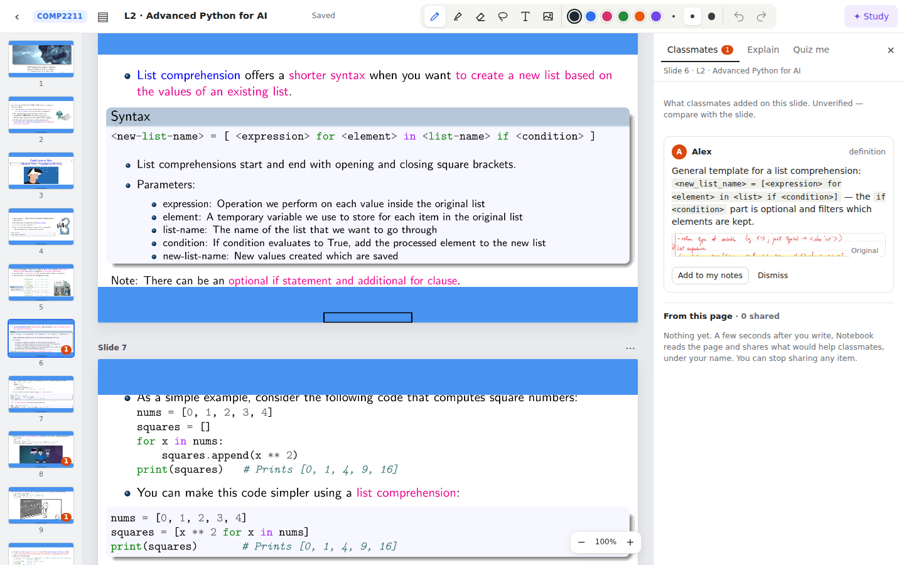

# Notebook — a course notebook that quietly learns from your classmates

Take notes the way you already do: write on lecture slides with a pen or mouse, type, paste images, or import notes exported from Goodnotes/Flexcil. While you write, Notebook reads each page with a multimodal model, links it to the right lecture and slide, and shares the useful parts (explanations, missing steps, examples) with classmates. When you come back to a slide, a quiet "2 classmate notes" pill shows what others captured. Nothing changes your notes unless you add it.



## Features

- **Courses first**: the front page lists all your courses (cover, lectures, notebooks, classmates, last edit) plus other courses to join, and lets you create one. Opening a course goes to its file tree (`#course=<id>`); the top bar shows `Notebook / COMP2211`, and leaving a notebook returns to where it was opened. Lectures, notebooks, classmates' notes and suggestions are all scoped to the course, and notes are only shared with students enrolled in it.
- **One free file tree per course**: folders anywhere, files moved by long-press/right-click (`Move to…`) or drag, and two ordinary starting folders, **Lectures** and **Quizzes**, which you can rename or delete. **My notes** (files you have written on) and **All files** are smart views above the tree, not folders. Official decks are ordinary files: they keep their `L#` and `PDF` badge and a ✎ count wherever they are filed, and opening one is what creates your own copy.
- **Notebook editor**: pressure-sensitive pen, highlighter, stroke eraser, lasso (select, move, delete, explain), text boxes, images, undo/redo, zoom, stylus-only mode for tablets, page thumbnails, insert pages after any slide, autosave with revision checks.
- **Course knowledge base**: shortly after you leave a notebook, its slides' notes are grouped into points of knowledge, with an AI-written summary per group; a single classmate's note is shown verbatim, never rewritten. Sources are never listed — cards say *From 3 classmates' notes*, *From slide 12*, or *AI explanation*. A note that contradicts the slide is excluded from every prompt and suggestion, and its author sees why.
- **Automatic sharing, no controls**: joining or creating a course explains that notes are shared, and there is deliberately no Stop sharing or Manage sharing in the demo. Items the model could not read or link stay private, with the reason shown to their author.
- **Inline suggestions**: a small marker appears beside the page where something is missing; tapping it opens a card in place, with *Add to my notes* (a separate sticky note) and *Dismiss* (remembered), plus *Not helpful* and *Looks wrong* (which rechecks the note and hides it while that is decided). Nothing covers the page, and the panel stays closed unless you open it.
- **Circle to ask**: lasso a part and get a popover beside it with *Explain*, *Example*, *Why?* chips and an optional typed question; the answer appears in the same popover with its sources.
- **Quiz me** is a future plan, not part of the demo (see [Future plan](#future-plan-quiz-me)).

No retrieval index: a lecture's slide digests and classmate notes fit easily in DeepSeek's 1M-token context window, so each request sends the whole lecture context. See `docs/superpowers/specs/2026-11-02-notebook-v2-design.md`.

## Run

Requires Node ≥ 24 and poppler-utils (`pdftoppm`, `pdftotext`, `pdfinfo`).

```bash
npm ci
cp .env.example .env          # set LLM_API_KEY (official DeepSeek, model deepseek-flash)
npm run seed -- "Flexcil PDFs 2026-11-01 23.58.58.zip"   # or a folder of PDFs
npm run dev                   # http://127.0.0.1:5173
```

To add another course: `npm run seed -- <folder-or-zip> --code COMP3311 --name "Database Management Systems"` (files named `N-title.pdf` become lecture N; `*notes.pdf` becomes Alex's notebook), or create it in the app and add lecture PDFs there.

The seed imports `N-*-full.pdf` lectures and `supp-model-evaluation-full.pdf`, digests every slide with the model, and imports `COMP2211 notes.pdf` as **Alex's** handwritten notebook (indexed and shared). Switch the demo student at the top right: **Thomas** (you), **Alex** (has notes), **Priya** (empty). Demo identities are not authentication; the server binds to loopback.

Production: `npm run build && npm start` serves the built app on port 4310.

## Test

```bash
npm run check                 # unit/API tests (mock model) + typecheck + production build
npm run test:e2e              # Playwright, with a deterministic mock OpenAI server (never calls the live API)
node scripts/live-smoke.mjs   # optional: real DeepSeek smoke run against a running dev server with seeded data
```

If the default Playwright browser is missing, set `PLAYWRIGHT_CHROMIUM_EXECUTABLE` to a cached Chromium (e.g. `~/.cache/ms-playwright/chromium_headless_shell-1243/chrome-headless-shell-linux-arm64/chrome-headless-shell`).

## Layout

- `server/` — Fastify API (`app.ts`), SQLite store (`db.ts`), model gateway (`ai.ts`), PDF rendering (`pdf.ts`), page rendering/cropping (`render.ts`), background digest and indexing jobs (`jobs.ts`), Explain/Quiz (`study.ts`), imports (`importer.ts`), seed CLI (`seed.ts`).
- `shared/` — types and ink geometry (perfect-freehand), used by both client and server.
- `src/` — React app: `Library.tsx`, `editor/` (Editor, PageView, Toolbar, PageChrome), `panel/` (Classmates/Explain/Quiz, source viewer).

## Future plan: Quiz me

Agreed with the user on 4 Nov 2026. **Not part of the demo.** The demo focuses on the course file tree, the shared course knowledge base and inline suggestions. Quiz me will be built later and leaves the study panel.

The `POST /api/quizzes` and `/api/quizzes/:id/grade` routes are still in place (and tested), so the future UI has something to call, but no screen in the demo reaches them.

- **Entry**: a shortcut in the editor (circle a part → "Quiz me on this", or a header button) opens a quiz builder for the course. It is not a tab in the study panel.
- **Material**: the student picks any files in the course: lecture PDFs (official slides), their own notebooks or pages, imported PDFs, and earlier quiz results. Only the picked files are used; classmates' knowledge is not added automatically.
- **Grounding**: questions are built only from the picked files. Every correct answer must cite one of the supplied materials (validated server-side); uncited questions are dropped. All sources count equally: if a note disagrees with a slide, the quiz tests what the files say. This replaces the earlier rule that answers must be supported by an official slide.
- **Question types**: multiple choice (graded locally) and short answer (typed), graded by the model against the cited material, with feedback on what is missing.
- **Flow**: choose how many questions; answer one at a time with immediate feedback and source links.
- **Results are files**: each quiz session is saved automatically in the course's built-in **Quizzes** folder. Internally it is stored in a format the model can read (so a past quiz can be material for a new one); in the library the student opens it to review the session: questions, their answers, score and feedback.
- **Memory**: attempts are kept; per-topic results support "Retry my mistakes" and weak-spot quizzes. Topics come from the lecture topic index.
- **Depends on**: the course file tree (with the built-in Lectures and Quizzes folders) and the lecture topic index, both planned for the demo.
- **Still open**: whether a retake adds an attempt to the same quiz file or creates a new one, and how per-topic progress is shown.

## Limits

Model quality (handwriting transcription, slide linking, explanations) has been spot-checked on the real COMP2211 material, not evaluated with students. Single-machine SQLite, no auth, no multi-device sync, no LMS integration.
