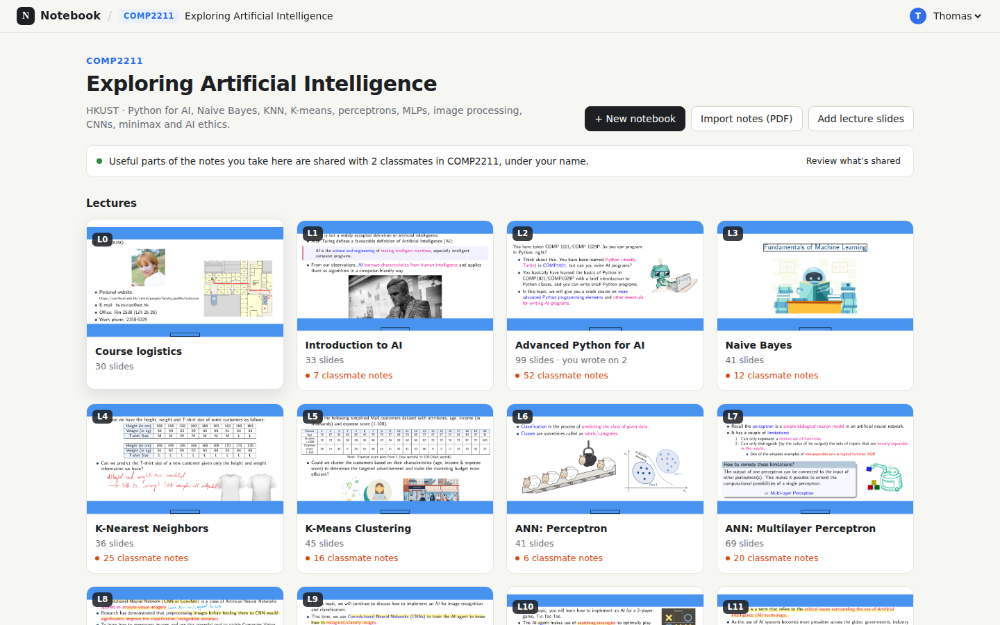

# Notebook

A local-first course notebook that reads what you write, links it to the right lecture slide, and quietly offers what classmates understood — without ever showing you a wall of other people's notes.

Write on slides with a pen, type, paste images, or import a Goodnotes/Flexcil export. A multimodal model transcribes the page, finds the slide it belongs to, and a background job merges the class's notes into a **course knowledge base**. Suggestions arrive inline beside the gap they fill. Named sharing is separate: send a classmate an editable copy, co-edit a group note, or go live as the professor.



This repository is the working prototype for **EMIA2020 Fall 2026 — Smart Education**. It is a demo, not a production LMS: no authentication, one SQLite file, and the server only listens on loopback.

## Contents

- [What you need](#what-you-need)
- [Hardcoded Demo](#hardcoded-demo)
- [Quick start](#quick-start)
- [Environment variables](#environment-variables)
- [Demo accounts](#demo-accounts)
- [Everyday commands](#everyday-commands)
- [How the app works](#how-the-app-works)
- [Project layout](#project-layout)
- [Testing](#testing)
- [Working together](#working-together)
- [Troubleshooting](#troubleshooting)
- [Local production and deployment](#local-production-and-deployment)
- [Known limits](#known-limits)
- [Where to read next](#where-to-read-next)

## What you need

| Requirement             | Notes                                                                                                                                                      |
| ----------------------- | ---------------------------------------------------------------------------------------------------------------------------------------------------------- |
| **Node.js 24+**         | The repo pins engines to `>=24`. Use the checked-in `package-lock.json`.                                                                                   |
| **npm**                 | `npm ci` is the supported install; do not commit `node_modules/`.                                                                                          |
| **poppler-utils**       | `pdftoppm`, `pdftotext` and `pdfinfo` turn lecture PDFs into page images and text.                                                                         |
| **Python 3**            | Only needed when seeding from a `.zip` (the seed uses `zipfile` to extract the PDFs).                                                                      |
| **A DeepSeek API key**  | Optional to start the app, required for digests, transcription, suggestions, Ask and quizzes. The official endpoint and `deepseek-flash` are the defaults. |
| **Playwright Chromium** | Optional, only for the browser tests. `npx playwright install chromium` if the default browser is missing.                                                 |

Check the runtime with `node -v`. With nvm: `nvm install 24 && nvm use 24`.

On Debian/Ubuntu:

```bash
sudo apt-get install poppler-utils python3
```

On macOS:

```bash
brew install poppler python3
```

The COMP2211 PDFs are large and are not ours to redistribute. You can seed with any folder of lecture PDFs you are allowed to use, or create a course in the app as the Professor and upload decks there.

## Hardcoded Demo

With Node.js 24+ and Poppler installed, run:

```bash
npm ci
npm run demo:hardcoded
```

Open [Four Operations](http://localhost:4313/#course=arith101&view=all). Start with **A student**, then switch to **B student** from the course view. Both accounts can edit their sample notes and use **Save me!** to see preset feedback. The demo needs no API key and saves its changes locally under `data/hardcoded-demo/`. Set `HARDCODED_DEMO_PORT` to use a different port.

## Quick start

```bash
git clone https://github.com/Thomas-Zheng0910/EMIA2020-Fall2026-smart-education.git
cd EMIA2020-Fall2026-smart-education

npm ci
cp .env.example .env
# Edit .env and set LLM_API_KEY. Leave it empty to run without AI.
```

Start the app:

```bash
npm run dev
```

Open **http://127.0.0.1:5173**. The Vite client proxies `/api` to the Fastify API on `127.0.0.1:4310`. Both halves watch: edits to `src/` reload the browser, edits to `server/` restart the API.

If port 4310 is already taken (for example by the hosted demo), run the isolated pair instead:

```bash
npm run dev:local        # client :5174, API :4312
```

> **No lecture PDFs?** Skip the seed. Start the app, switch to **Professor**, and create a course with any PDF you are allowed to use. The seeded COMP2211 course is a convenience, not a requirement.

### Seed the demo course

The seed imports lecture PDFs, renders their slides, asks the model to digest each slide, and imports a handwritten notebook for Alex. It needs a folder (or a Flexcil-style `.zip`) containing PDFs named like this:

| File name                        | Becomes                               |
| -------------------------------- | ------------------------------------- |
| `1-intro.pdf`, `2-python.pdf`, … | Lecture 1, 2, …                       |
| `12-ethics.pdf`                  | Lecture 12                            |
| `COMP2211 notes.pdf`             | Alex's handwritten notebook           |
| `supp-model-evaluation-full.pdf` | Lecture 12 supplement (COMP2211 only) |

Files without a leading number (and not ending in `notes.pdf`) are ignored. Rename your PDFs to match, or add the course through the app instead.

```bash
npm run seed -- /path/to/lecture-pdfs
# or, for a Flexcil export:
npm run seed -- "/path/to/Flexcil export.zip"

# Another course:
npm run seed -- /path/to/pdfs --code COMP3311 --name "Database Management Systems" --description "…"
```

Seeding is slow on purpose: every slide is a model call. The seed prints `digested X/Y slides` every 15 seconds; a full 13-lecture, 636-slide COMP2211 seed takes roughly 25 minutes on the live model. Without `LLM_API_KEY`, slides are imported but not digested, and AI features return a clear "AI not configured" error.

A seeded database starts with suggestions based on the official slides only; the knowledge base fills in after someone leaves a notebook (or after the 10-minute sweep).

### Reset the database

Stop the dev server, then remove the runtime data directory and seed again:

```bash
rm -rf data
npm run seed -- /path/to/lecture-pdfs
```

`data/` contains the SQLite database, uploaded PDFs, rendered slide images and logs. Everything in it is disposable and ignored by git.

## Environment variables

Copy `.env.example` to `.env`. The file is git-ignored; never commit a key.

| Variable          | Default                       | Purpose                                                                                           |
| ----------------- | ----------------------------- | ------------------------------------------------------------------------------------------------- |
| `LLM_BASE_URL`    | `https://api.deepseek.com/v1` | OpenAI-compatible endpoint.                                                                       |
| `LLM_API_KEY`     | empty                         | Provider key. Empty means "AI not configured", not a crash.                                       |
| `LLM_MODEL`       | `deepseek-flash`              | Must be multimodal (the app sends page images).                                                   |
| `PORT`            | `4310`                        | API port. Vite proxies to this unless `API_PORT` is set.                                          |
| `DATA_DIR`        | `./data`                      | SQLite, uploads, rendered pages. Keep it out of git.                                              |
| `INDEX_DELAY_MS`  | `6000`                        | Pause after writing before a page is re-read and shared.                                          |
| `ALLOWED_ORIGINS` | empty                         | Extra exact origins allowed to call the API (comma-separated), e.g. a Cloudflare Tunnel hostname. |

The e2e suite overrides the LLM variables with its own mock server. It never calls the live provider.

## Demo accounts

There is no login. Switch identity from the avatar menu in the top right.

| Account       | Role                   | Use it for                                                                |
| ------------- | ---------------------- | ------------------------------------------------------------------------- |
| **Thomas**    | Student                | The default student view. Has some writing on lecture 2.                  |
| **Alex**      | Student                | Owns the imported `COMP2211 notes.pdf` notebook and its shared fragments. |
| **Priya**     | Student                | Empty student, useful for checking a first-run experience.                |
| **Professor** | Instructor of COMP2211 | Create courses, add official decks, re-digest slides, go live.            |

These identities are **not authentication**. The API accepts an `x-student-id` header, and the server binds to `127.0.0.1`; keep it that way. Course-scoped routes also require `x-course-id` and check enrollment, so do not test sharing by bypassing the headers.

## Everyday commands

| Command                           | What it does                                                        |
| --------------------------------- | ------------------------------------------------------------------- |
| `npm run dev`                     | Client + API with watch, `:5173` → `:4310`.                         |
| `npm run dev:local`               | Same, on `:5174` → `:4312`, when `:4310` is busy.                   |
| `npm run seed -- <folder-or-zip>` | Import lectures and Alex's notebook.                                |
| `npm run build`                   | Typecheck and build the client into `dist/`.                        |
| `npm start`                       | Serve the built app and API on `:4310` (reads `.env`).              |
| `npm run serve`                   | Watch-and-rebuild supervisor used by the hosted demo.               |
| `npm test`                        | Unit/API tests with the mock model.                                 |
| `npm run test:e2e`                | Playwright browser scenarios on their own ports.                    |
| `npm run check`                   | `npm test` + typecheck + production build. Run before opening a PR. |
| `node scripts/live-smoke.mjs`     | Optional smoke run against the real provider (costs API calls).     |

## How the app works

```text
Browser: React 19 + Vite
   │  /api (fetch)
   ▼
Fastify API (server/)
   ├─ SQLite + files in data/       courses, enrollments, notebooks, pages, ink, shares
   ├─ background jobs               slide digests, page indexing, merge-and-check, sweeps
   └─ ModelGateway (server/ai.ts)    DeepSeek, multimodal
```

1. **Courses and the library.** Every course has its own file tree. A student joins a course rather than creating a folder. Two ordinary folders, **Lectures** and **Quizzes**, are seeded once per student per course; **My notes** and **All files** are smart views, not folders. All reads and writes are scoped by `x-course-id` + enrollment.
2. **Writing.** The editor stores vector ink and page items. Autosave sends a revision with each page; a stale write is rejected rather than overwriting a classmate. Typing is saved while you type, so leaving the page never saves an empty box.
3. **Indexing.** After a pause (or when the notebook is closed), the server renders the page plus an ink-only image and asks the model to transcribe it, link it to a slide, and judge whether it is clear and adds something. Only confident, linked notes are shared (`SHARE_THRESHOLD`). Results are written only if the page revision has not changed; annotation-only edits do not trigger a model call.
4. **The knowledge base.** When a student leaves a notebook, `server/jobs.ts` groups each slide's notes into `knowledge_entries` with an AI summary. Single-source entries keep the note verbatim. Entries that contradict the slide are excluded from prompts and suggestions. Sources are never listed to students, and classmates are never named.
5. **Suggestions and Ask.** Prompts send the whole lecture (slide digests + visible classmate knowledge) — there is no RAG or embedding index by design. Model citations are validated server-side against the references actually supplied. Suggestions appear inline at the gap in the writing column; accepting one adds a separate `annotation` item and never rewrites the student's ink.
6. **Named sharing.** **Send a copy** gives one classmate a pullable or snapshot copy in **Shared with me**. **Invite to co-edit** turns a note into a group note with owner/editor members and object-level merge. **Go live** is the professor's read-only handout; ending it leaves every student a copy. Direct shares are raw and named, and they are never ingested into the anonymous AI bank.

Read `AGENTS.md` before changing behavior. It records the invariants the code depends on: course isolation, AI never modifying student ink, annotation-only edits not re-triggering indexing, the anonymous bank staying separate from named shares, and no fabricated AI output when the provider is missing.

## Project layout

```text
server/            Fastify API and background work
  app.ts             routes, auth headers, static client
  db.ts              SQLite schema + queries (additive migrations on start)
  ai.ts              model gateway; env config
  jobs.ts            digests, topic index, page indexing, merge-and-check, sweeps
  suggestions.ts     page gaps → suggestion cards
  study.ts           Ask, fill-gap, quiz, citation validation
  shares.ts          copies, pull/fetch, group notes, live handouts
  importer.ts        lecture PDFs, notebook PDFs, uploads
  render.ts          page renders, ink-only renders, handwriting crops
  seed.ts            CLI seed and demo identities
  index.ts           process entry point
shared/            types and ink geometry shared by client and server
src/               React client
  Home.tsx           course list / join / create
  Library.tsx        file tree, folders, drag and long-press menus
  editor/            Editor, PageView, Toolbar, PageChrome, autosave
  panel/             Ask, Suggestions, inline card, source viewer
  ShareDialog.tsx    send a copy / invite / go live
  NoticeCenter.tsx   received copies and invitations
  LiveViewer.tsx     read-only live handout
  styles.css         the whole visual system
tests/             unit/API tests (Vitest)
e2e/               Playwright scenarios + mock LLM (never the live API)
docs/              specs, handoff, progress, validation, screenshots
scripts/           live smoke and the serve supervisor
data/              runtime data (ignored)
```

## Testing

```bash
npm run check        # unit/API tests + typecheck + production build
npm run test:e2e     # Playwright, with e2e/mock-llm.mjs
```

The mock provider proves transport and control flow; it does **not** prove model quality. Model behaviour needs representative inputs and human review. Never point the automated tests at the live provider.

If Playwright cannot find a browser, either run `npx playwright install chromium` or set `PLAYWRIGHT_CHROMIUM_EXECUTABLE` to an existing Chromium binary. The e2e run uses its own ports (`:5174` / `:4311`), so it can run while a dev server is up.

A live smoke test is explicit and optional:

```bash
node scripts/live-smoke.mjs   # against a running, seeded server; costs API calls
```

## Working together

- **Branch from `main`.** Use `feat/<short-name>` or `fix/<short-name>`. Open a PR with what changed, why, and how you tested it. Keep unrelated refactors out of feature PRs.
- **Pull, then `npm ci`.** The lockfile is the source of truth. Do not upgrade dependencies in a feature PR unless that is the point of the PR.
- **Run `npm run check` before pushing.** If you touched the editor, sharing, or any API route, also run `npm run test:e2e`.
- **Never commit** `.env`, `data/`, `dist/`, `node_modules/`, `test-results/`, lecture PDFs/zips, or generated screenshots from `.oil-ui/`. They are git-ignored; if a new runtime artifact appears, add it to `.gitignore` instead of committing it.
- **Schema changes are additive.** Existing databases are upgraded on start; do not rewrite or drop tables that hold student work. Test with an old `data/notebook.sqlite` if you touch `db.ts`.
- **Update the docs with the behavior.** `AGENTS.md` holds invariants, `docs/superpowers/specs/` holds the current design, and `docs/HANDOFF.md` / `docs/PROGRESS.md` record what was done. If you change a flow, update the relevant note or explain why it no longer applies.
- **Respect the product decisions.** The demo shares notes automatically and has no Stop sharing for the AI bank. Named shares are not revocable. The professor's notes and group notes are not peer evidence. AI suggestions never name a classmate; direct shares do. These are deliberate, not bugs.
- **Keep the demo loopback-only.** The identities are fictional, but the API trusts headers. Do not expose it on a LAN without a real auth layer in front.

## Troubleshooting

| Symptom                                                      | Fix                                                                                                                                |
| ------------------------------------------------------------ | ---------------------------------------------------------------------------------------------------------------------------------- |
| `EADDRINUSE` on 4310                                         | Something (often the hosted demo) already owns the port. Use `npm run dev:local`, or stop the other process.                       |
| `pdftoppm: not found` while seeding                          | Install `poppler-utils` and reopen the shell.                                                                                      |
| `AI not configured` on every AI action                       | Set `LLM_API_KEY` in `.env` and restart the server. Seeding without a key imports slides but produces no digests.                  |
| Seeding looks stuck                                          | It is making one model call per slide. Watch the `digested X/Y` line; the 15-second tick can hide slow calls.                      |
| No course after a reset                                      | Run the seed again, or start the app and create one as **Professor**.                                                              |
| Playwright browser missing                                   | `npx playwright install chromium`, or set `PLAYWRIGHT_CHROMIUM_EXECUTABLE`.                                                        |
| Blank pages after deleting `data/` while the app was running | Stop the app first, delete `data/`, restart, and seed. SQLite and rendered files must disappear together.                          |
| A public hostname gets a CORS error                          | Add the exact `https://…` origin to `ALLOWED_ORIGINS` and restart.                                                                 |
| Tests suddenly call the real API                             | They should not. Check that you did not remove the `env` override in `playwright.config.ts`; the mock lives in `e2e/mock-llm.mjs`. |

## Local production and deployment

Build the client and serve the whole app from the API process:

```bash
npm run build
npm start                 # http://127.0.0.1:4310
```

`npm run serve` is the watch-mode supervisor used by the hosted demo: server edits restart the API and client edits rebuild `dist/`. `deploy/notebook.service` is the user-systemd unit template; `docs/DEPLOYMENT.md` documents the Cloudflare Tunnel setup for `notebook.zh-thomas.party`.

For a normal local demo, `npm run dev` is enough. Do not deploy the current app to a public host without adding authentication: every request may choose a demo identity.

## Known limits

- **Demo, not a LMS.** Single-machine SQLite, no real accounts, no multi-device sync, no LMS integration.
- **AI judgement is unreviewed.** Grouping notes, summarising them, and deciding a note contradicts the slide are single-shot model outputs. Spot-checked on COMP2211, not evaluated with a class.
- **No RAG by design.** The whole lecture fits in the context window; there is no embedding index to tune or inspect.
- **Co-editing is poll-based.** Object-level merge every 2.5 s and presence every 5 s, not CRDT or WebSocket. Simultaneous typing in one text box is last-write-wins.
- **Sharing is not revocable.** The AI bank is automatic, and named shares/copies cannot be recalled in the demo.
- **Quiz me is a future plan.** The `POST /api/quizzes` routes exist and are tested, but no demo screen reaches them.
- **No bundled course material.** Bring PDFs you are allowed to use.

## Where to read next

- [`AGENTS.md`](AGENTS.md) — invariants and user decisions; read this before changing behavior.
- [`docs/superpowers/specs/2026-11-02-notebook-v2-design.md`](docs/superpowers/specs/2026-11-02-notebook-v2-design.md) — editor, library, paper.
- [`docs/superpowers/specs/2026-11-04-knowledge-base-inline-suggestions.md`](docs/superpowers/specs/2026-11-04-knowledge-base-inline-suggestions.md) — knowledge base, suggestions, Ask.
- [`docs/superpowers/specs/2026-11-05-sharing-live-and-group-notes.md`](docs/superpowers/specs/2026-11-05-sharing-live-and-group-notes.md) — named sharing, group notes, live.
- [`docs/HANDOFF.md`](docs/HANDOFF.md) and [`docs/PROGRESS.md`](docs/PROGRESS.md) — current state and history.
- [`docs/DEPLOYMENT.md`](docs/DEPLOYMENT.md) — Cloudflare Tunnel and the hosted service.
